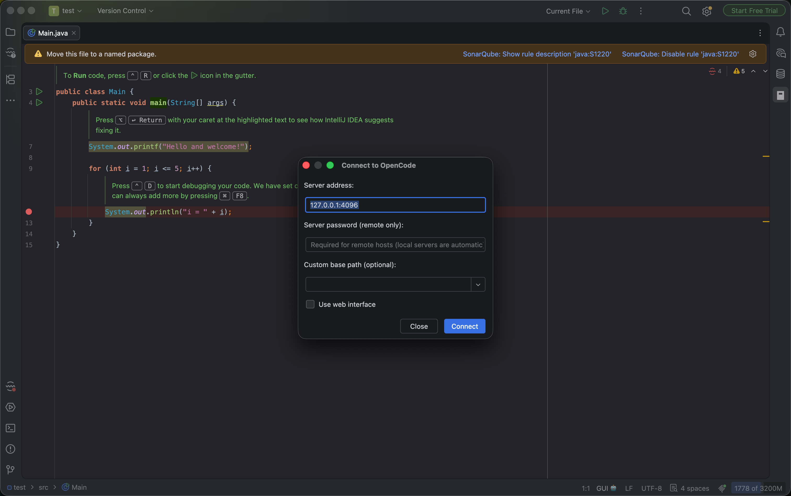
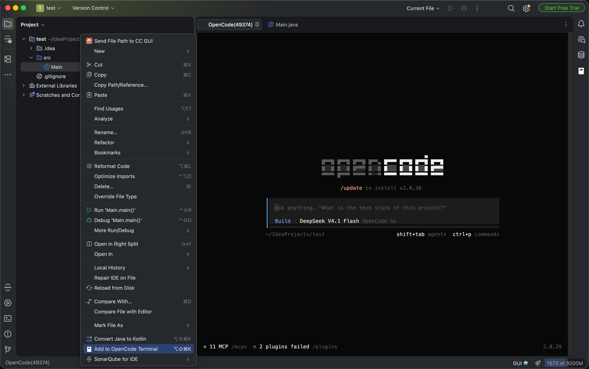
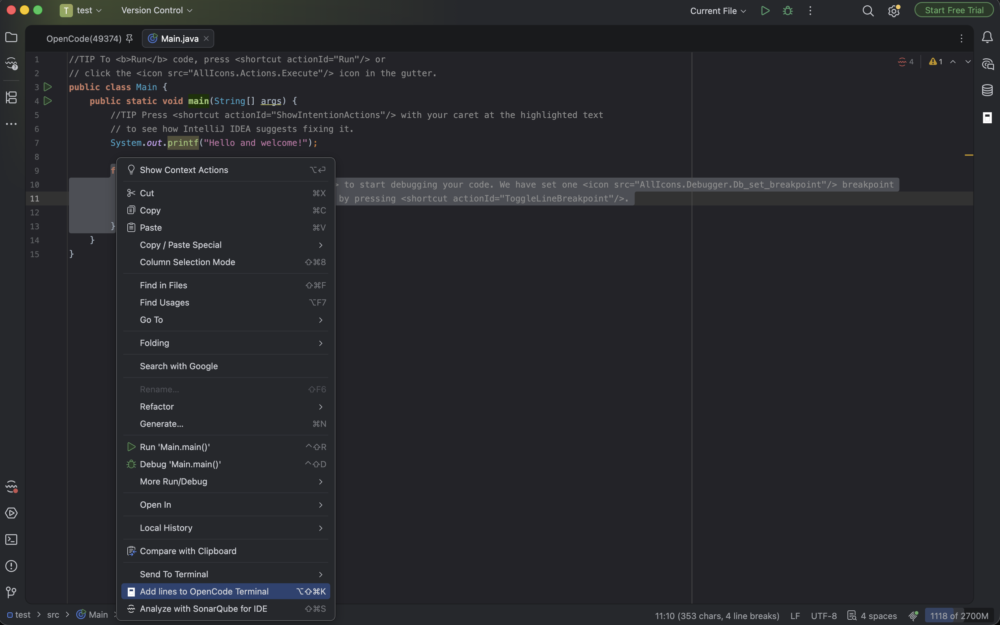
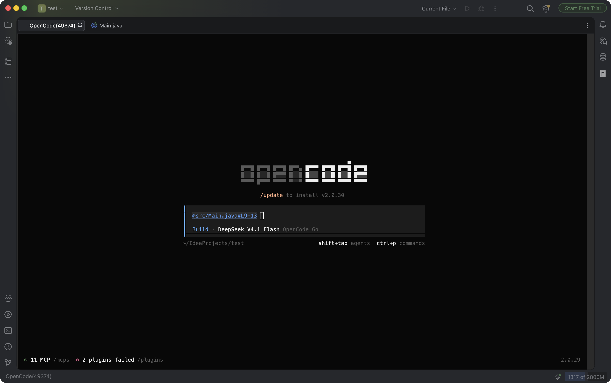
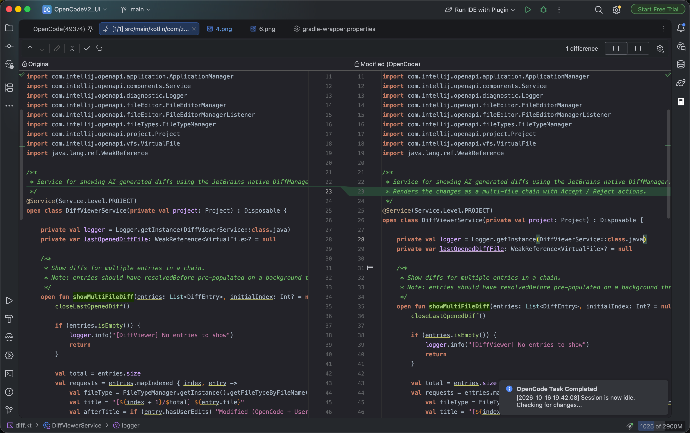

# OpenCode V2 UI (unofficial)

[](https://plugins.jetbrains.com)
[](https://opencode.ai)

A JetBrains IDE plugin that integrates [OpenCode V2](https://opencode.ai) — the open-source AI coding agent — directly into your development workflow.

> **This is a community derivative of [OpenCode UI](https://github.com/LaiZhou/OpenCode_UI)** by LaiZhou,
> **For opencode v2 support only!!!**.

## Features

| Feature | Description | Shortcut (Mac) | Shortcut (Win/Linux) |
|---------|-------------|----------------|----------------------|
| **Quick Launch** | Connect to existing OpenCode server or create new terminal | `Cmd + Esc` | `Ctrl + \` |
| **Add to Terminal** | Send current file/selection or selected files to OpenCode | `Opt + Cmd + K` | `Ctrl + Alt + K` |
| **Diff Review** | View diffs and accept/reject changes in IDE | — | — |
| **Notifications** | System alert when task completes | — | — |
| **Auto-Resume** | Restore last session on launch | — | — |
| **Smart Links** | Clickable file paths in terminal | — | — |
| **Auth Support** | Basic auth password (auto-discovered for local, required for remote) | — | — |
| **Local Change Alert** | Warn when local edits differ from AI output | — | — |
| **Web UI Mode** | Open the opencode web UI in an IDE tab (JCEF) instead of the terminal | — | — |

### Feature Comparison with Claude Code

| Feature | Claude Code | OpenCode |
|---------|-------------|----------|
| Quick Launch | ✅ | ✅ |
| Diff Viewing | ✅ | ✅ |
| File Reference Shortcuts | ✅ | ✅ |
| Diagnostic Sharing | ✅ | ❌ (uses built-in LSP) |

### Sidebar Icon

Click the **OpenCode V2** icon in the right sidebar to instantly focus or create an OpenCode terminal session.

### Context Menus

- **Editor**: Right-click in the editor → **Add lines to OpenCode V2 Terminal** (last item in the menu)
- **Project View**: Right-click on files/folders → **Add to OpenCode V2 Terminal**
- **Tools menu**: **Tools** → **Open OpenCode V2** (same action as the Quick Launch shortcut)

## Requirements

- **JetBrains IDE**: IntelliJ IDEA, WebStorm, PyCharm, etc. — **2024.2** or later (`since-build 242`).
  The plugin is compiled against IntelliJ Platform 2024.2 (so the bytecode runs on the JBR 21 that
  ships with those builds) and verified against the current releases.
- **OpenCode v2 CLI**: the plugin targets opencode **v2** (verified with 2.0.x) and warns once when it
  connects to a different major version.

  - macOS / Linux: `brew install anomalyco/tap/opencode-v2`
  - Other platforms: see [opencode.ai/download](https://opencode.ai/download)

  > **Note**: v2 conflicts with v1's `opencode` formula — both install an `opencode` binary — so remove
  > v1 first (`brew uninstall opencode`) if you have it. The npm package `opencode-ai` is the **v1**
  > line, not v2.

## Installation

> **Not published on the Marketplace yet.** This is a **separate plugin** (id `com.zhucanle.opencodev2.ide`),
> distinct from the original *OpenCode UI*, so the two can be installed side by side.

Build it from source and install the resulting zip:

```bash
./gradlew buildPlugin
```

Then open **Settings** → **Plugins** → ⚙ → **Install Plugin from Disk…** and pick
`build/distributions/OpenCodeV2_UI-<version>.zip`, then restart the IDE.

## Usage

### 1. Launch OpenCode Terminal

Press `Cmd+Esc` (Mac) or `Ctrl+\` (Win/Linux) to open the connection dialog. Two modes are supported:

- **Local (default)**: The plugin uses the opencode v2 **background service**. If the service is not
  running it starts it (`opencode service start`), discovers its URL via `opencode service status`,
  and reads its Basic auth password from `service.json` in the opencode config directory
  (`~/.config/opencode/service.json`, or `%APPDATA%\opencode\service.json` on Windows). It then opens
  a TUI terminal tab (e.g. `OpenCode(49374)`) attached to that same service. The dialog host/port are
  ignored for local use — the service owns its port, and the password is discovered automatically.
- **Remote / existing server**: Enter `host:port` (e.g., `10.0.0.5:4096`) and the **password** to
  connect to a server started with `opencode serve` on another machine. opencode v2 requires HTTP
  Basic auth (`opencode:<password>`) on every request, so the password is required; `opencode serve`
  prints it to stdout at startup.
- **Web interface (optional)**: tick **Use web interface** in the dialog to open the opencode web UI
  (`/doc`) in an IDE tab backed by JCEF instead of the terminal tab. The choice is remembered along
  with the other connection settings. Requires JCEF support in the IDE (present in all mainstream
  JetBrains IDEs; without it the terminal tab is used).
  The web tab is registered through the `com.intellij.modules.jcef` module, which exists from
  **2026.2** on; on 2024.2–2025.x the plugin runs in terminal mode only.

*Your last connection settings (address, mode, password) are remembered automatically.*



### 2. Send Code Context to OpenCode

In the editor or Project View, press `Opt+Cmd+K` (Mac) or `Ctrl+Alt+K` (Win/Linux).

- If the OpenCode terminal is not open yet, the plugin creates/focuses it automatically.
- In the editor, it shares the **current file** even if nothing is selected.



The plugin will send:

- **Editor selection**: `@path/to/file.kt#L10-25`
- **Editor (no selection)**: `@path/to/file.kt`
- **Project View selection**: `@path/to/file.kt` for each selected file



This allows OpenCode to understand the context of your question or request.

### 3. Sidebar Button

Click the **OpenCode V2** icon in the right sidebar to quickly focus or create the opencode terminal.



### 4. Review Diffs

When OpenCode edits files, the plugin opens a native IDE diff viewer.

- **Chronological View**: Changes are shown in the order they were made, starting from the first modified file.
- **Navigation**: Use **← →** arrows to switch files and **↑ ↓** arrows to jump between changes.
- **Trigger**: The diff viewer opens automatically when OpenCode finishes a response (session idle).
- **Progress**: The title shows your review progress (e.g., `1 of 5`) for multi-file changes.
- **Accept**: Writes the AI's changes to disk and stages the file (git add). Automatically opens the next file.
- **Reject**: Restores the file to its state before the AI started editing. Automatically opens the next file.
- **Local Modified**: The diff title shows `(Local Modified)` when your file differs from AI output.



### 5. Task Notifications

The plugin sends a system notification when OpenCode finishes a task (transitions from Busy to Idle). This allows you to switch to other work while the AI is generating code, and be notified immediately when it's done.

> **Tip**: To receive desktop notifications, please ensure your operating system allows notifications for the JetBrains IDE (e.g., on macOS: *System Settings > Notifications > IntelliJ IDEA*).

### 6. Smart File Links

File paths in the terminal output (e.g., `@src/main/kotlin/Main.kt#L10-20`) are clickable. Clicking them opens the file in the editor and highlights the referenced lines.

## Keyboard Shortcuts

All shortcuts are customizable via **Settings** → **Keymap** → search for "OpenCode".

| Action (label shown in Keymap) | Mac | Windows/Linux |
|--------------------------------|-----|---------------|
| `Open OpenCode V2` (Quick Launch) | `Cmd + Esc` | `Ctrl + \` |
| `Add lines to OpenCode V2 Terminal` (editor) | `Opt + Cmd + K` | `Ctrl + Alt + K` |
| `Add to OpenCode V2 Terminal` (Project View) | `Opt + Cmd + K` | `Ctrl + Alt + K` |

## Terminal Management

The plugin uses a single terminal tab per project named **"OpenCode({port})"**.

- Only one OpenCode terminal session per project
- The terminal persists across plugin actions
- Closing the terminal tab will create a new one on next launch

## Troubleshooting

### "opencode: command not found"

Install the opencode **v2** CLI:

```bash
brew install anomalyco/tap/opencode-v2   # macOS / Linux
```

Other platforms: [opencode.ai/download](https://opencode.ai/download)

### "OpenCode Version Mismatch" warning

The plugin targets opencode **v2** and warns once when it connects to a different major version. Check
which CLI is on your `PATH`:

```bash
opencode --version
```

v1 shipped as the npm package `opencode-ai` and the Homebrew formula `opencode`; v2 ships as the
Homebrew formula `opencode-v2`. They **conflict** — both install a binary named `opencode` — so keep
only one installed.

### Terminal not responding

Try closing the "OpenCode({port})" terminal tab and pressing `Cmd+Esc` or `Ctrl+\` again to create a fresh session.

### Shortcuts not working

1. Check for conflicts in **Settings** → **Keymap**
2. Search for your shortcut to see if it's assigned to another action
3. Reassign or remove conflicting shortcuts

## Credits and Acknowledgements

This project is a derivative work based on **[OpenCode UI](https://github.com/LaiZhou/OpenCode_UI)** by
**LaiZhou**, licensed under the MIT License. Credit to the original author and to everyone who
contributed to it — the full commit history is preserved in this repository:

- **LaiZhou** — original project: plugin architecture, terminal/diff/notification features, docs
- **Milos Zivkovic** — connection dialog base-path field, project-module selector
- **Michael Bauer** — README improvements

Changes made in this derivative:

- opencode **v2** support (background service discovery, `/api` HTTP + SSE surface)
- a distinct plugin id, display name, tool window id and action ids, so this plugin and the
  original can be installed **side by side**
- the same default keyboard shortcuts as the original (`Cmd+Esc` / `Opt+Cmd+K` on macOS).
  If you install both plugins, rebind one of them in **Settings → Keymap**

See the [commit history](https://github.com/ZhuCanle/OpenCodeV2_UI/commits/main) for the full record.

## Support

- **Bugs / feature requests for this plugin**: [open an issue](https://github.com/ZhuCanle/OpenCodeV2_UI/issues)
- [OpenCode Documentation](https://opencode.ai/docs)
- [OpenCode CLI issues](https://github.com/anomalyco/opencode/issues)
- [Discord Community](https://opencode.ai/discord)

## License

MIT License. See [LICENSE](LICENSE) for details. This project retains the original copyright notice of
"OpenCode UI" by LaiZhou, as required by the MIT License.
